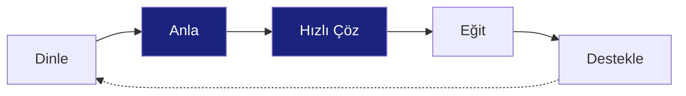

# Hüseyin Emre

### **Yapay Zeka Destekli Full-Stack Geliştirici | Donanım Entegrasyon Sorumlusu**

*"Önce insanı anlarım, sonra sistemi kurarım."*

---

### Hakkımda

Sahada çalışan bir geliştiriciyim. Bir sorunun teknik tarafını çözmek kadar, sorunu yaşayan kişiyi anlamanın da işin parçası olduğunu düşünüyorum.

- **İnsanı anlarım.** Kullanıcının ne söylediğiyle neye ihtiyaç duyduğu her zaman aynı şey değil. İkisini ayırt etmek benim işim.
- **Hızlı teşhis ederim.** Kasa durmuşsa, fiş yazıcı çalışmıyorsa ya da satışlar bekliyorsa önce kök nedeni bulurum; doğru soru, doğru çözümün yarısıdır.
- **Yapay zeka ile hızlı üretirim.** Modern araçları (LLM'ler, kod asistanları, otomasyon) iş akışımın merkezine koydum. Bu sayede küçük ekiplerle büyük işler çıkarıyorum.
- **Anlatırım.** Kurduğum sistemi kullanacak kişiye eğitim vermeden işi bitmiş saymam. Anlaşılmayan sistem, kullanılmayan sistemdir.

---

### Çalışma Biçimim

Dinle, anla, hızlı çöz, anlat, yanında kal.

---

### Deneyim

**Uygulama Geliştirici** · MetaThings Bilgi Teknolojileri — *Haz 2026 – Devam · Yarı zamanlı · Hibrit*
Uygulama mimarisi, proje geliştirme ve teknik destek.

**Proje Geliştirme / Yazılım Geliştirme** · İskenderun Teknik Üniversitesi XR LAB — *Nis 2025 – Devam · Hibrit*
XR odaklı projelerde yazılım geliştirme.

**ERP Functional & Technical Consultant** · Hisar Yazılım ve Barkodlu Satış Sistemleri — *Haz 2025 – Haz 2026 · Hibrit*
ERP kurulumu, özelleştirme, saha donanımı entegrasyonu (barkod okuyucu, fiş yazıcı) ve son kullanıcı eğitimi.

**IT Altyapı ve Sistem Destek Stajyeri** · Osmaniye Belediyesi — *Haz 2023*
Sunucu ve ağ yönetimi, yedekleme operasyonları, uçtan uca teknik destek.

<b>Eğitim</b>

 

- **İskenderun Teknik Üniversitesi** — Yönetim Bilişim Sistemleri (Lisans) · *Eki 2024 – Haz 2027* · **GPA: 3.57**
- **Osmaniye Korkut Ata Üniversitesi** — Bilgisayar Programcılığı (Ön Lisans) · *2021 – 2023*

<b>Sertifikalar</b>

 

- **Yapay Zeka ile Üretkenlik Akademisi** — Coderspace · *Mar 2026*
- **Cloud** — Coderspace · *Şub 2025*

---

### Kullandığım Araçlar

| Geliştirme | Veri | İş & Saha |
| :--- | :--- | :--- |
| Python | PostgreSQL | ERP kurulum ve özelleştirme |
| Dart / Flutter | SQL | Süreç analizi |
| JavaScript | Git | Donanım entegrasyonu |
| LLM API'leri ve kod asistanları | Cloudflare | Kullanıcı eğitimi |

---

### Projeler

| Proje | Ne yapıyor | Teknoloji |
| :--- | :--- | :--- |
| **Kampüs Bildirim Sistemi** | Öğrencinin kampüsteki sorunu fotoğraf ve konumla bildirdiği, görevlinin üstlenip sonuç fotoğrafıyla kapattığı akış. Yapay Zeka Destekli Yazılım Geliştirme dersi ekip projesi. | Flutter, Dart (Shelf), PostgreSQL |
| **Büyük Konsey (LLM Council)** | Birden fazla modelin bağımsız yanıt verdiği, birbirini anonim puanladığı ve bir başkan modelin sentezlediği üç aşamalı karar sistemi. | Python, React |
| **huseyinemre.tech** | Portfolyo sitesi. Mozilla Observatory A+ (120/100), HSTS Preload listesi, CSP ve SRI ile sertleştirildi. | Vanilla JS, Vite, Cloudflare Workers |

---

### Şu An

- Özel ERP modülleri ve saha verisinin gerçek zamanlı senkronizasyonu üzerinde çalışıyorum.
- Yapay zeka destekli geliştirme akışlarını kendi iş süreçlerime uyarlıyorum.
- Açık kaynak iş süreci otomasyonu araçlarına katkı arıyorum.

---

### İletişim

- **Sor bana:** yapay zeka destekli geliştirme, ERP süreçleri, donanım entegrasyonu, kullanıcı eğitimi
- **E-posta:** [huseyinemre.tech@gmail.com](mailto:huseyinemre.tech@gmail.com)
- **Portfolyo:** [huseyinemre.tech](https://huseyinemre.tech)

  

