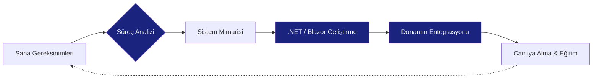

#  Hüseyin Emre
### **Full-Stack Geliştirici | Donanım Entegrasyon Sorumlusu**
*"Karmaşık iş süreçleri ile zarif dijital çözümler arasında köprü kuruyorum."*

---

### 🏛️ "Değer Köprüsü"

Teknoloji benim için ofiste başlayıp sahada, müşterinin yanında anlam kazanan bir süreç. Kod yazmakla kalmıyor; iş akışını optimize eden sistemler tasarlıyorum.

> **Yaklaşım**: Anla ➡️ Tasarla ➡️ Geliştir ➡️ Sahada Çalıştır ➡️ Destekle

---

### 💼 Deneyim

**🧩 Uygulama Geliştirici** · MetaThings Bilgi Teknolojileri — *Haz 2026 – Devam · Yarı zamanlı · Hibrit*
Uygulama mimarisi, proje geliştirme ve teknik destek.

**🥽 Proje Geliştirme / Yazılım Geliştirme** · İskenderun Teknik Üniversitesi XR LAB — *Nis 2025 – Devam · Hibrit*
XR odaklı projelerde yazılım geliştirme.

**🏢 ERP Functional & Technical Consultant** · Hisar Yazılım ve Barkodlu Satış Sistemleri — *Haz 2025 – Haz 2026 · Hibrit*
ERP kurulumu, özelleştirme, kullanıcı eğitimi ve Blazor ile süreç dijitalleştirme.

**🖥️ IT Altyapı ve Sistem Destek Stajyeri** · Osmaniye Belediyesi — *Haz 2023*
Sunucu/ağ yönetimi, yedekleme operasyonları, uçtan uca teknik destek.

<b>🎓 Eğitim</b>

 

- **İskenderun Teknik Üniversitesi** — Yönetim Bilişim Sistemleri (Lisans) · *Eki 2024 – Haz 2027* · **GPA: 3.57**
- **Osmaniye Korkut Ata Üniversitesi** — Bilgisayar Programcılığı (Ön Lisans) · *2021 – 2023*

<b>📜 Sertifikalar</b>

 

- **Yapay Zeka ile Üretkenlik Akademisi** — Coderspace · *Mar 2026*
- **Cloud** — Coderspace · *Şub 2025*

---

### 🛠️ Teknoloji Yığını

| 💻 Geliştirme | 🗄️ Mimari & Veri | ⚙️ ERP & Saha |
| :--- | :--- | :--- |
|  |  |  |
|  |  |  |
|  |  |  |

---

### 🚀 Öne Çıkan Projeler

| Proje | Ne yapıyor | Stack |
| :--- | :--- | :--- |
| **Büyük Konsey (LLM Council)** | Çoklu LLM'i aynı masaya oturtan 3 aşamalı konsey: bağımsız yanıt → anonim eleştiri/puanlama → başkan sentezi | Python, React |
| **[huseyinemre.tech](https://huseyinemre.tech)** | Portfolyo + güvenlik sertleştirme: Mozilla Observatory **A+ (120/100)**, HSTS Preload listesi, CSP, SRI, Cloudflare | Web |

---

### 🌱 Şu An

- 🔭 **Üzerinde çalışıyorum:** Özel ERP modülleri ve saha verisinin gerçek zamanlı senkronizasyonu
- 📚 **Öğreniyorum:** DDD, Clean Architecture, Blazor performans optimizasyonu
- 🤝 **Birlikte çalışmak istiyorum:** Açık kaynak .NET araçları ve iş süreci otomasyonu

---

### 📊 İstatistikler

---

### 📫 İletişim

- 💬 **Sor bana:** `.NET`, `Blazor`, `ERP entegrasyonları`, `donanım entegrasyonu`
- 📧 **Ulaş:** [huseyinemre.tech@gmail.com](mailto:huseyinemre.tech@gmail.com)
- 🌐 **Portfolyo:** [huseyinemre.tech](https://huseyinemre.tech)

  

